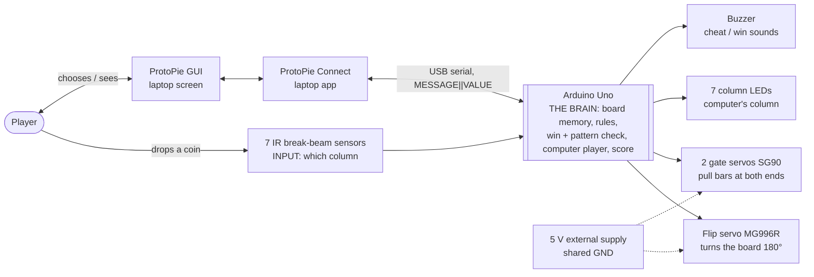

# 07 · Presentation (EX2, 28 Oct 2026)

The team fills the professor's template in Figma Slides: https://www.figma.com/slides/k9LasGtEKIIYfWlgTlsmq8 (team notes and task split in FigJam: https://www.figma.com/board/VZNR8pWM3hTzOPEdv5kL9L).

## The professor's rules (from the presenter notes in the template)

- **Don't change the number of slides.** Fonts, colours and pictures can change.
- Slide 1: group number and project title (a logo is allowed).
- Slide 2: project description: the game, the problem, the environment and behaviour.
- Slide 3: the users. Personas are allowed but **not mandatory**. Who uses the device (direct and indirect users)?
- Slide 4: how the device works: a storyboard or text describing the interactions (board and app).
- Slides 5–6: the device. **The block diagram is mandatory** (blocks or circuit; the final circuit is not needed). A flow chart is optional.
- The talk is about **3 minutes**.

## Who does which slide

| Slide | Content | Who |
|---|---|---|
| 1–2 | Title, description | Airika (sets the style) |
| 3 | Personas: strategy fan (Marco) | Danny (done) |
| 3 | Personas: solo player | Yujia |
| 4 | Storyboard | Airika |
| 5 | Flow chart | Yujia |
| 6 | Block diagram | Danny (done) |
| all | Polish | anyone with time |

Slides 5 and 6 came as two identical "Flow chart and/or Block diagram" slides, so slide 5 is the flow chart and slide 6 is the block diagram. The template's example content on slide 6 is hidden, not deleted.

## Persona: Marco Ferri, the strategy seeker (slide 3)

The team agreed on two personas (one per target community in the first proposal): a solo player (Yujia) and a player who is bored of plain Four-in-a-Row and wants a new approach to the classic (Danny). The third template persona card is hidden.

- **Marco Ferri, 27**, product designer, Milan. Photo: the template's stock photo for now.
- **Quote:** "I know Connect Four by heart. Give me the game I know, with something new to think about."
- **Who:** plays chess online and board games with friends every week. The classic feels "solved": same openings, over in minutes.
- **Needs:** rules everyone already knows, but more to plan, more ways to win, and a real board to share with friends.
- **Frustrations** (not on the slide, for questions): new strategy games take an hour to learn; screen-only games lose the fun of dropping real coins.
- **How our game fits:** the visible flip pattern is a second goal to build or block, and the physical flip makes him ask "what happens upside down?" before every move.

## Block diagram (slide 6)

Text version of the slide, so it can be edited and reviewed in the repo:

Colour code on the slide: blue = input, black = brain, orange = output, white = interface / power. Parts and pins are in [03-hardware.md](03-hardware.md); messages in [04-software.md](04-software.md). If the hardware changes, update the slide and this diagram together.
